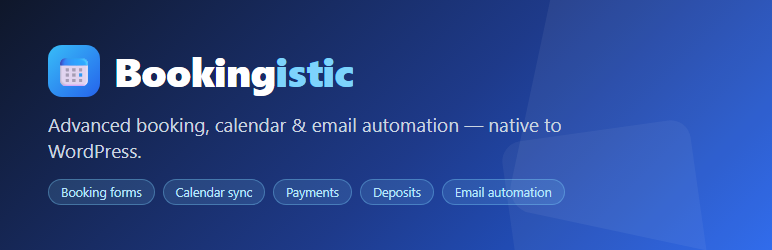

<p align="center">
  <a href="https://bookingistic.com"></a>
</p>

<p align="center"><strong>Advanced booking, calendar &amp; email automation for WordPress.<br>Services, staff scheduling, availability rules, four form designs, Google Calendar sync and WooCommerce payments — one free plugin.</strong></p>

<p align="center">
  <a href="https://github.com/Wordpressistic/bookingistic/releases/latest"></a>
  <a href="LICENSE"></a>
  
  
</p>

<p align="center">
  <a href="https://bookingistic.com">Website</a> ·
  <a href="https://wordpress.org/plugins/bookingistic/">WordPress.org</a> ·
  <a href="https://github.com/Wordpressistic/bookingistic/releases/latest">Download</a> ·
  <a href="CHANGELOG.md">Changelog</a> ·
  <a href="https://wordpress.org/support/plugin/bookingistic/">Support</a>
</p>

---

## What is Bookingistic?

Bookingistic turns a WordPress site into a premium booking system — for strategy calls, salons, clinics, tutors, fitness trainers, consultants, home services and any appointment-based business. It is built by [WordPressistic](https://www.wordpressistic.com) ("Build Your Business Automation with AI") and is part of the WPistic suite alongside [Bridgistic](https://github.com/Wordpressistic/bridgistic), the safe AI-control bridge for WordPress.

Everything in this repository is **free and open source** — no feature gates, no license keys, no in-plugin upsell.

| Area | What you get |
| --- | --- |
| **Booking forms** | 4 production-ready designs — Classic, Modern Card, Split Hero, Minimal Inline — switchable per site or per shortcode, all theme-overridable |
| **Calendar views** | Month grid, mobile-first 14-day pills scroller, or upcoming list with Today/Tomorrow labels |
| **Scheduling engine** | Durations, buffers, slot intervals, per-day staff hours, days off, holidays, daily limits, min-notice, max-advance window, timezone-aware slots, double-booking guard (row-locked, race-safe) |
| **Google Calendar** | Free .ics attachments + "Add to Google Calendar" links on every site; optional two-way sync per staff member via your own free OAuth client |
| **Email automation** | Branded HTML confirmations, reminders, cancellation/reschedule notices, event-driven automation rules, full send log |
| **Payments** | Paid services check out through a WooCommerce order per booking (any gateway your store supports); deposits, signed expiring pay links, payment ledger; pluggable gateway registry |
| **Elementor** | Drag-and-drop Bookingistic Form widget with live service/template/calendar controls |

## Requirements

- WordPress **6.4+**, PHP **8.0+**
- Optional: [Elementor](https://wordpress.org/plugins/elementor/) for the drag-and-drop widget
- Optional: a free Google OAuth client for two-way calendar sync (setup guide lives in **Bookingistic → Integrations**)
- Optional: [WooCommerce](https://wordpress.org/plugins/woocommerce/) for paid bookings

## Installation

**From WordPress.org** — Plugins → Add New → search "Bookingistic" → Install → Activate.

**From a release zip** — download `bookingistic-<version>.zip` from [Releases](https://github.com/Wordpressistic/bookingistic/releases/latest), then Plugins → Add New → Upload Plugin.

**From source** —

```bash
git clone https://github.com/Wordpressistic/bookingistic.git
cp -r bookingistic /path/to/wp-content/plugins/
```

## Getting started

1. Activate the plugin, then open **Bookingistic → Appearance** and pick an industry preset (Salon, Clinic, Fitness, Tutoring, Consulting, Home Services) — or design your own look with the accent color and corner-radius controls.
2. Add your bookable services under **Bookingistic → Services** (duration, buffers, price, deposit, auto/manual confirmation).
3. Add staff under **Bookingistic → Staff** — per-day working hours, days off, holidays, daily booking limits, and (optionally) each member's Google Calendar.
4. Place the form on any page:

   ```
   [bookingistic service="strategy-call"]
   [bookingistic service_id="1" template="split" calendar_view="pills"]
   ```

   — or drag in the **Bookingistic Form** widget in Elementor.
5. Paid services: enable **WooCommerce Orders** under **Bookingistic → Payments**. Customers pay with any method your store already supports and payment status flows back to the booking automatically.
6. Optional: connect Google Calendar per staff member under **Bookingistic → Integrations** for two-way sync — confirmed bookings push out, external events block slots, refreshed every 15 minutes.

Customers book without an account; cancel and reschedule work through signed, expiring links in their emails.

## REST API

```
GET  /wp-json/bookingistic/v1/services
GET  /wp-json/bookingistic/v1/availability?service_id=N&date=YYYY-MM-DD
POST /wp-json/bookingistic/v1/bookings
POST /wp-json/bookingistic/v1/bookings/{id}/reschedule
GET  /wp-json/bookingistic/v1/payments
GET  /wp-json/bookingistic/v1/payments/gateways
```

The public `bookings` endpoint is honeypot- and rate-limit-protected; staff email addresses are never exposed. Backward compatibility with the v1 `wpistic_booking` CPT and the legacy `POST /wpistic/v1/bookingistic/request` route is maintained.

## For developers

```php
// Filter available slots before render
add_filter( 'bookingistic_available_slots', fn( $slots, $service, $date, $staff_id ) => $slots, 10, 4 );

// Inject external busy intervals (the Google freebusy integration uses this)
add_filter( 'bookingistic_external_busy_intervals', fn( $intervals, $staff_id ) => $intervals, 10, 2 );

// React to the booking lifecycle
add_action( 'bookingistic_booking_confirmed', function ( $booking, $customer, $service ) { /* ... */ }, 10, 3 );

// Add a payment gateway (implements Bookingistic\Payments\Payment_Gateway)
add_filter( 'bookingistic_payment_gateways', function ( array $gateways ) {
    $gateways['my_gateway'] = new My_Gateway();
    return $gateways;
} );

// White-label: remove the email footer credit (free for everyone since 2.5.1)
add_filter( 'bookingistic_can_remove_branding', fn() => true );
```

Architecture notes: namespaced OOP under `Bookingistic\` with PSR-4-style autoloading from `includes/`, dedicated custom tables (services, staff, customers, bookings, payment records, email automations, email logs, calendar events), and an opt-in data wipe on uninstall via `BOOKINGISTIC_DELETE_DATA`.

## External services & privacy

The plugin makes **no** external CDN calls and ships no telemetry.

The only optional external integration is **Google Calendar**, and only after a staff member explicitly connects their own free OAuth client from the staff editor:

- Used for: pushing confirmed bookings to the connected calendar and reading its free/busy blocks so external events block booking slots.
- Data sent, and when: booking details (service name, date/time, customer name and notes) when a connected staff member's booking is confirmed, rescheduled or deleted.
- Endpoints: `accounts.google.com`, `oauth2.googleapis.com`, `www.googleapis.com`.
- [Google Terms of Service](https://policies.google.com/terms) · [Google Privacy Policy](https://policies.google.com/privacy)

Bookings, customers and email logs are stored in the site's own database. OAuth tokens are encrypted at rest; calendar (.ics) email attachments are written to the system temp directory and deleted after sending.

## Support

- **Usage questions:** the [WordPress.org support forum](https://wordpress.org/support/plugin/bookingistic/).
- **Bugs and feature ideas:** open an issue here using the templates.
- **Security vulnerabilities:** never in public — see [SECURITY.md](SECURITY.md).
- **Commercial / partnership inquiries:** [support@wpistic.com](mailto:support@wpistic.com).

## Contributing

Pull requests are welcome — see [CONTRIBUTING.md](CONTRIBUTING.md) for the development setup, coding standards and the release process. Please note this project is released under GPL-2.0-or-later and contributions are licensed under the same terms. Everyone is expected to follow our [Code of Conduct](CODE_OF_CONDUCT.md).

## License

Bookingistic is licensed under the [GNU General Public License v2.0 or later](LICENSE) — the same license as WordPress itself. You may use, study, modify and redistribute it freely, including in commercial projects.

Copyright (C) WordPressistic LLC. The "Bookingistic", "WordPressistic" and "WPistic" names, logos and branding are trademarks of WordPressistic LLC and are not covered by the plugin's GPL code license.
